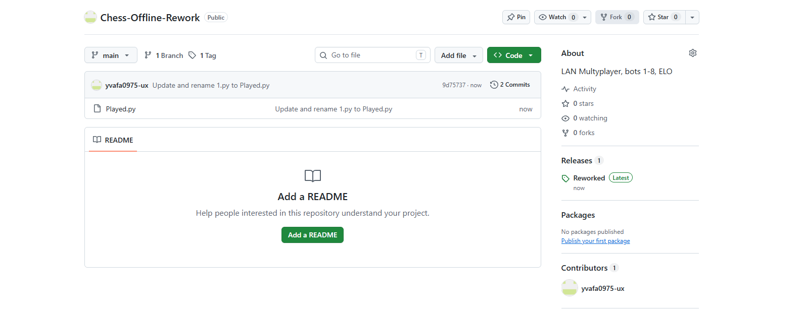
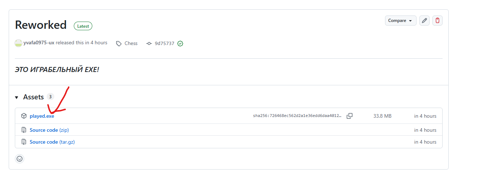
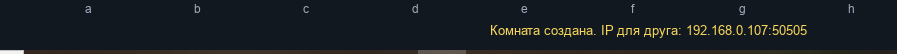
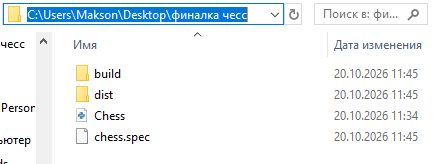

ЗДРАВСТВУЙТЕ - ЕСЛИ ВЫ ХОТИТЕ ПОТРЕНИРОВАТЬСЯ, НО МЕШАЕТ СТРЕСС? ТЕБЕ СЮДА!

Как же, можно установить эту игрушку?

Нажимаете на Releases:

Нажимаете на played.exe

Вы можете запустить игру так и с ботами - так и с тем человеком, который подключен к той же сети, которая у вас!

Нажимаете на "Игра по LAN" >>> Выбрать

Нажимаете "Создать комнату"

И у вас внизу появляется желтым IP для того - чтобы ваш друг подключился

Как подключится человеку - с кем хотите сыграть:

Ваш человек у себя жмет "Игра по LAN" >>> Выбрать

И стоп!

Ваш человек не должен нажать на "Cоздать комнату" а должен ввести тот IP, который выдал вам сервер

Как только ваш человек ввел айпи - он моментально подключается)

2) Если вы боитесь сразу с Releases брать exe - вы можете сделать его сами!

Что понадобится? Качаете Python 3.12

библиотека pygame

библиотека uvicorn

библиотеке chess

библиотека FastAPI

библиотека requests

2.1) Создайте отдельную папку на рабочем столе с любым названием

    Внесите туда Played.py

    Откройте через адрессную строку >>> командную строку

    Клавиша BackScape >>> прописываете cmd

    

    И пишите туда только так! По другому - игра либо сломается, либо фигурки у ботов не смогут ходить и мультиплеер будет выдавать ошибку!

    >>> Пишите строго так:
    python -m pip install pyinstaller
    python -m PyInstaller --noconfirm --clean --onefile --windowed --collect-all uvicorn --collect-all fastapi --collect-all starlette --collect-all pydantic --collect-all pygame --collect-all chess --collect-all requests Played.py

    Теперь в этой папке появятся 2 папки >>> Это dist и build

    Build нам вообще не нужны, нас интересует dist

    Там вы уже найдете Played.exe

    Спасибо!

